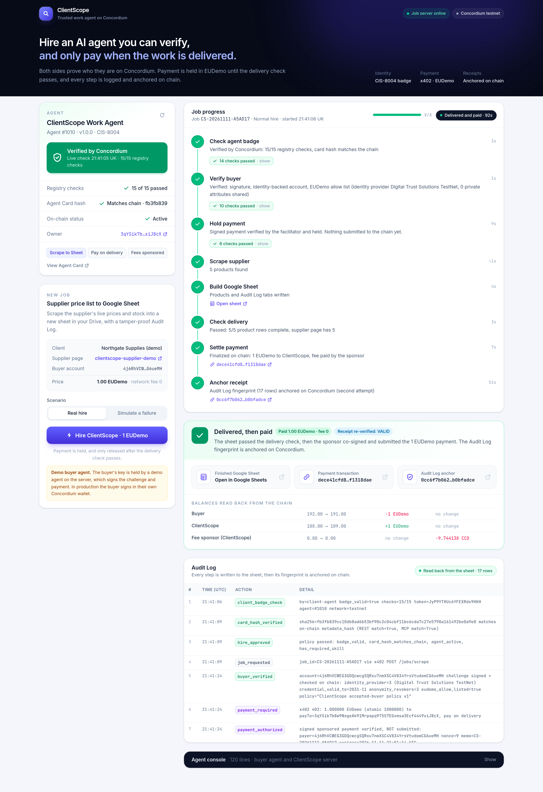
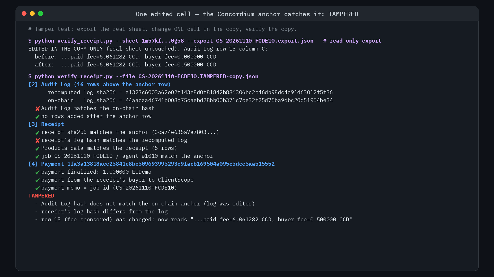
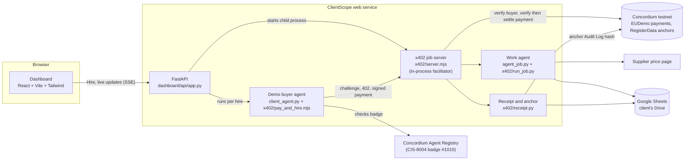
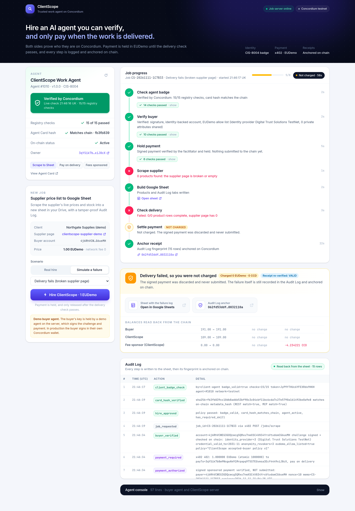
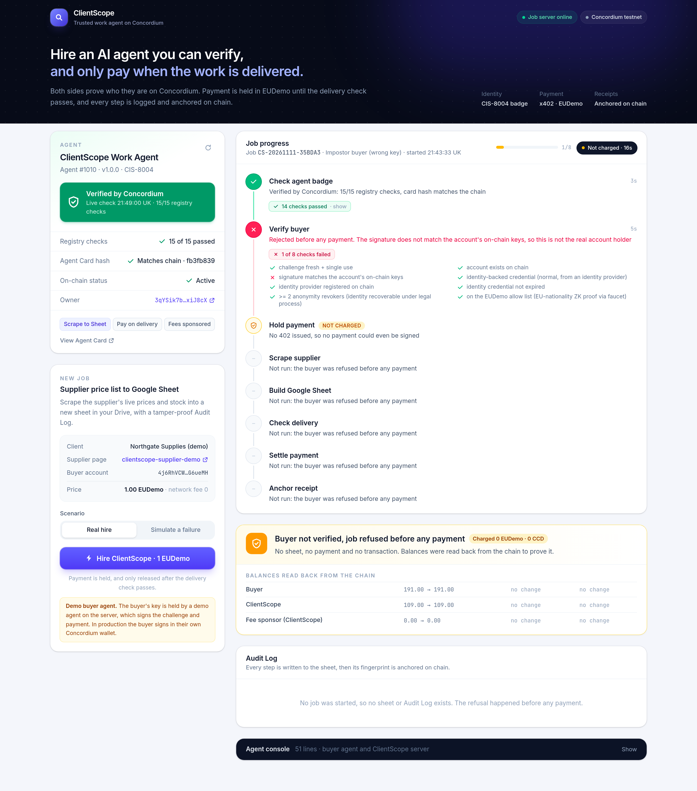

# ClientScope

**An AI work agent that a business hires for one job at a time. It only gets paid when the work is delivered, and every action it takes is logged and fingerprinted on chain.**

Built for the **Concordium Trusted Agents hackathon** with **Encode Club**. Everything runs on the Concordium **testnet**: no real money moves.



## What it does

A small business wants its supplier's latest prices and stock levels in a spreadsheet. It hires ClientScope for that one job:

1. The buyer's agent (itself registered on Concordium as agent #1211) checks that ClientScope is a registered, verified agent (#1010), then makes ClientScope sign a fresh nonce with a key that controls #1010, so a copied Agent Card is worthless.
2. ClientScope checks the buyer too: its registered agent badge, card hash and Active status, a fresh challenge signed by the key that controls that agent, who is asking, and whether they are allowed to pay.
3. The buyer signs a payment of 1 EUDemo (a test euro stablecoin). ClientScope holds it but does not take it yet.
4. ClientScope reads the supplier's price page ([Northgate Supplies demo site](https://henry-n41.github.io/clientscope-supplier-demo/)), creates a new Google Sheet by itself in the client's Google Drive, and writes a Products tab and an Audit Log tab.
5. A delivery check re-opens the sheet and compares it with the supplier page. Only if it passes is the payment submitted. If it fails, the signed payment is thrown away and the buyer is not charged.
6. A fingerprint (SHA-256 hash) of the finished Audit Log is written to the Concordium blockchain, so anyone can later prove the log was not edited.

## The four trust features

| # | Feature | What it means for the client | Where in the code |
|---|---------|------------------------------|-------------------|
| 1 | **Pay on delivery** with [x402](https://www.x402.org/) on Concordium testnet | The client signs a payment up front, but it is only submitted after the delivery check passes. ClientScope's sponsor account pays the network fee, so the client pays 0 CCD in fees. | `x402/server.mjs`, `x402/pay_and_hire.mjs`, `x402/run_job.py` |
| 2 | **Tamper-proof Audit Log** | Every job, delivered or failed, gets a receipt. Its Audit Log fingerprint is anchored on chain with a `RegisterData` transaction. `verify_receipt.py` re-hashes the sheet and prints VALID or TAMPERED, down to the row that changed. | `x402/receipt.py`, `x402/anchor_tool.mjs`, `verify_receipt.py` |
| 3 | **Buyer verification** | Before quoting a price, ClientScope asks the buyer to sign a one-time challenge and checks public chain data: the signature matches the account's keys, the account is backed by a real identity from a registered identity provider, the credential is valid, the identity can be recovered by at least 2 anonymity revokers, and the account is on the EUDemo allow list (granted after a zero-knowledge proof of EU nationality). No name or other private detail is shared. | `x402/buyer_check.mjs` |
| 4 | **Live dashboard with a Hire button** | A web page where anyone can hire ClientScope and watch each step happen live, including failure scenarios that show "Not charged" with balances read back from the chain. | `dashboard/` |

ClientScope itself also carries a **Verified by Concordium** badge: agent #1010 in Concordium's CIS-8004 agent registry. The buyer agent checks the badge and the hash of ClientScope's [Agent Card](https://henry-n41.github.io/clientscope-supplier-demo/agent-card.json) against the chain before it hires.



## Architecture



How a hire flows: the dashboard API runs the demo buyer agent, which checks the badge, proves who it is, gets a `402 Payment Required` answer, checks the price against its spend limit (2 EUDemo, ClientScope only) and signs the payment. The x402 server verifies the payment without submitting it, runs the job and the delivery check, then settles (sponsor co-signs and submits) only on a pass, appends the payment receipt to the Audit Log, and anchors the receipt on chain.

## Tech stack

- **Chain:** Concordium testnet, `@concordium/web-sdk`, CIS-8004 agent registry, EUDemo protocol-level token (PLT)
- **Payments:** x402 (`@x402/core`, `@x402/express`, `@x402/fetch`, `@x402/concordium`) on Express, with sponsored transactions
- **Work agent:** Python, `requests` and Beautiful Soup for the page, `gspread` and Google OAuth for Sheets
- **Dashboard:** React 19, Vite 7, Tailwind CSS 4, FastAPI with Server-Sent Events
- **Hosting:** Render (one web service, see `render.yaml`)

## Real testnet evidence

Main hire from the dashboard, job **CS-20261111-A5AD17** (11 Nov 2026, delivered and then paid, receipt verified as VALID):

| What | Link |
|------|------|
| Google Sheet the agent created | [1lgFjF3eVx3ejMvYcnitBDsQGcTmVUsUB6Sq7ToIEU4I](https://docs.google.com/spreadsheets/d/1lgFjF3eVx3ejMvYcnitBDsQGcTmVUsUB6Sq7ToIEU4I) |
| Payment, 1 EUDemo, fee paid by the sponsor | [dece41cf…1318dae](https://ccdexplorer.io/testnet/transaction/dece41cfd875a9306ebf42e94e7f3b629574ac2c549ed547537d2d96f1318dae) |
| Audit Log anchor (`RegisterData`) | [0cc6f7b0…0bfadce](https://ccdexplorer.io/testnet/transaction/0cc6f7b0621947e282857a088c389bb8a5a8922d4a8c2942b18c2a1db0bfadce) |
| The receipt itself | [docs/evidence/CS-20261111-A5AD17.json](docs/evidence/CS-20261111-A5AD17.json) |

Failure scenarios on the dashboard, where the buyer was not charged:

| Delivery fails its check | Impostor buyer is refused |
|---|---|
|  |  |

## Run it locally

Requirements: Python 3.13, Node.js 24, a Concordium testnet buyer account and sponsor account (the public addresses are in `x402/config.mjs`), and a Google OAuth client for the Sheets API.

```bash
# 1. Install
python -m venv .venv && .venv/bin/pip install -r requirements.txt
npm ci --prefix x402
npm ci --prefix dashboard/web && npm run build --prefix dashboard/web

# 2. Google sign-in, once (creates .secrets/token.json, which is git-ignored)
#    Put your OAuth client file at .secrets/oauth_client.json first.
.venv/bin/python auth_start.py          # open the printed link and approve
.venv/bin/python auth_finish.py "<the full redirect URL>"

# 3. Keys only ever come from the environment
export CCD_CLIENT_PRIVATE_KEY=...   CCD_SPONSOR_PRIVATE_KEY=...

# 4. Start the dashboard (it starts the x402 job server for you)
.venv/bin/uvicorn dashboard.api.app:app --host 127.0.0.1 --port 8000
# open http://127.0.0.1:8000
```

`dashboard/run.sh` does steps 1 (front end only) and 4 in one go. You can also run the parts in a terminal without the dashboard:

```bash
node x402/server.mjs                                  # the paid job server
.venv/bin/python client_agent.py                      # a normal hire
.venv/bin/python client_agent.py --simulate-delivery-fail
.venv/bin/python client_agent.py --simulate-unverified-buyer impostor
.venv/bin/python verify_receipt.py --sheet <sheet id> # check any receipt
```

## Deploy on Render

The repo includes a [Render Blueprint](https://render.com/docs/blueprint-spec) (`render.yaml`) for one free web service.

1. In Render, choose **New**, then **Blueprint**, and pick this repository.
2. Render reads `render.yaml`. It installs the Python and Node dependencies, builds the dashboard, and starts `uvicorn` on Render's `$PORT`. The FastAPI app starts the x402 job server on an internal port.
3. When asked, fill in the three secret values listed below. They are stored in Render, not in the repo.
4. Open the service URL. `/api/health` should answer `{"ok": true, ...}`.

Free Render services sleep when idle, so the first visit can take up to a minute. Run history and buyer sessions live in memory and on the service's temporary disk, so a restart clears them. Receipts stay safe on chain and in the sheets.

## Environment variables

| Name | Secret | Required | What it is |
|------|--------|----------|------------|
| `CCD_CLIENT_PRIVATE_KEY` | Yes | Yes | Signing key (64 hex characters) of the demo buyer's Concordium testnet account. Used to sign the buyer challenge and the payment. |
| `CCD_SPONSOR_PRIVATE_KEY` | Yes | Yes | Signing key (64 hex characters) of ClientScope's operator account, which sponsors fees, settles payments and sends anchors. |
| `GOOGLE_TOKEN_JSON` | Yes | Yes, when there is no token file | The full contents of the Google OAuth token JSON (`.secrets/token.json`), including the refresh token, client ID and client secret. |
| `GOOGLE_TOKEN_FILE` | No | No | Path to a token file. Default `.secrets/token.json`. If the file exists it is used before `GOOGLE_TOKEN_JSON`. |
| `CCD_GRPC_HOST` | No | No | Concordium gRPC node. Default `grpc.testnet.concordium.com`. |
| `CCD_GRPC_PORT` | No | No | gRPC port. Default `20000`. |
| `CCD_GRPC_TLS` | No | No | `true` (default) or `false`. |
| `CLIENTSCOPE_X402_PORT` | No | No | Internal port of the x402 job server. Default `4021`. |
| `CLIENTSCOPE_X402_HOST` | No | No | Bind address of the x402 job server. Unset means all interfaces; Render uses `127.0.0.1` so only the dashboard is public. |
| `CLIENTSCOPE_CORS` | No | No | Comma-separated origins allowed to call the API from another site. Not needed when the page and API share one URL. |
| `CLIENTSCOPE_PYTHON` | No | No | Python interpreter for child scripts. Default: `.venv/bin/python` if it exists, otherwise the current interpreter (`python3` for the job server). |
| `PORT` | No | Set by Render | Port the dashboard listens on. |

Keys are never returned by any endpoint, and every log line sent to the browser passes through a redaction step.

## Repository layout

```
agent_job.py          the work agent: scrape the supplier page into a new Google Sheet with an Audit Log
client_agent.py       demo buyer agent: badge check, then hire and pay over x402
verify_receipt.py     independent receipt checker: VALID or TAMPERED
google_creds.py       loads the Google token from a file or GOOGLE_TOKEN_JSON
auth_start.py, auth_finish.py   one-time Google sign-in
x402/                 pay-on-delivery job server, buyer checks, receipts and chain helpers (see x402/README.md)
dashboard/            live dashboard: FastAPI API and React front end (see dashboard/README.md)
client-agent-card/    prepared CIS-8004 registration for the buyer agent (not sent yet)
docs/                 screenshots and the main job's receipt
render.yaml           Render Blueprint
```

## Limits worth knowing

- This is a testnet demo. In the hosted demo, one shared buyer wallet pays for every hire and every sheet goes to one Google account, so only one hire runs at a time. In production each client would sign with their own Concordium wallet and pay for their own job.
- The buyer's key is held by the demo buyer agent on the server, and the dashboard says so. In production the buyer would sign in the Concordium Browser Wallet.
- Replay protection and buyer sessions are kept in memory. On-chain nonce protection still holds after a restart.
- The public testnet node can be slow. The dashboard retries a dropped anchor and stops a run that goes silent for 180 seconds.
- More detail is in [`x402/README.md`](x402/README.md).

## Roadmap

- **Next (feature 5):** a UK restock use case with a price-change alert.
- Register the buyer agent in the CIS-8004 registry (prepared in `client-agent-card/`).
- Connect the Concordium Browser Wallet so buyers sign for themselves.
- A job queue and a database for production use.

## License

[MIT](LICENSE)
